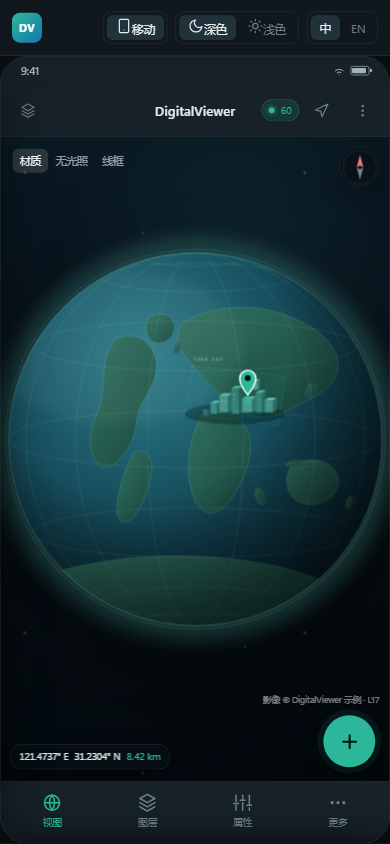

# DigitalViewer UI Design v1

本目录是 DigitalViewer v1.0 正式实现阶段的 UI 设计交付物。

| 文件 | 说明 |
| --- | --- |
| [ui-design-spec.md](ui-design-spec.md) | 设计规范：目标、布局、设计令牌、组件、状态、流程、i18n、Godot 实现映射、验收映射 |
| [ui-audit.md](ui-audit.md) | 工业级评审：评分、P0/P1/P2 问题、验收门与整改顺序 |
| [index.html](index.html) | **移动端**单视口原型（移动布局、深/浅色、中/英；桌面单视口仅保留历史参考） |
| [multi-viewport.html](multi-viewport.html) | **桌面 / Web** 多视口原型（递归分割、每视口图层树、拖放共享、独立设置） |
| [style.css](style.css) | 单视口原型样式与设计令牌 |
| [multi.css](multi.css) | 多视口分屏、三区视口标题栏、无背景图层树、独立窗口样式 |
| [app.js](app.js) | 单视口原型交互 |
| [multi.js](multi.js) | 多视口原型交互 |

> 产品拆分：`multi-viewport.html` 用于**桌面 + Web**（Web 下各面板只能停靠，不能独立成窗口）；`index.html` 只用于**移动端单视口**，移动端不提供脚本面板。

## 打开方式

打开 `index.html` 默认进入移动端 390×844；桌面布局仅保留历史参考，不作为交付目标。

- 桌面 / Web：`multi-viewport.html`
- Web（面板只能停靠）：`multi-viewport.html?platform=web`
- 移动端：`index.html`（默认 mobile）

预览页顶部提供：

- **设备**：移动 390×844；桌面/Web 请使用 `multi-viewport.html`。
- **主题**：深色（v1 正式）/ 浅色（设计验证）。
- **语言**：中文 / English，产品界面即时切换。
- **场景**：主界面、状态与诊断、添加数据、飞往坐标、设置、空场景、移动图层抽屉、移动属性面板。

也可以用 URL 参数直接进入状态，便于截图或评审：

```
index.html?device=mobile&lang=zh&scene=main
index.html?device=mobile&lang=en&scene=main
multi-viewport.html
multi-viewport.html?demo=2h&vp=1
multi-viewport.html?platform=web&demo=2h
```
multi-viewport.html?demo=4
multi-viewport.html?demo=6
multi-viewport.html?demo=2h&detach=2
```

`shot=1` 会隐藏评审工具栏并让画布填满窗口。多视口参数：`demo=2h|2v|4|6`（仅用于快速生成评审用分屏树）、`vp=1..N`、`detach=1..N`；不设视口数量或 `vp` 参数上限。

## 可直接体验的交互

- 图层：分组折叠、选中、显隐、状态（就绪/加载/暂停）、属性/配准/拾取/统计标签页。
- 应用菜单：点击左上角品牌区，打开关于 / 设置 / 退出；退出展示有序清理步骤，不绘制窗口控制按钮。
- 面板：右栏宽度可调、面板可关闭/重开；桌面可独立窗口，Web 只能停靠。
- 添加数据：WGS84 椭球、本地文件/目录、ZIP、远程地址、WMTS、Cesium ion、**GDScript 脚本**；添加脚本后生成“脚本”图层并打开脚本面板。
- 飞往：输入校验、坐标更新、飞行提示；视点保存/飞往/删除。
- 脚本：桌面/Web 底部面板，**可手工编辑 GDScript**，带行号、语法高亮、新建/打开/保存、运行/停止、输出与信任门；移动端不提供。
- 诊断：概览表、错误列表、复制/导出提示、展开与收起。
- 移动端：顶部栏、图层抽屉、属性/添加/飞往/状态/更多底部面板、安全区与触控尺寸；无 AI、无脚本入口。
- 多视口：不再使用全局左侧图层面板；每个视口标题栏三区布局：左侧 `图层树 + 添加`、中间视口名、右侧分割/分离/全屏/关闭。
- 平台约束：桌面可把属性/脚本拖出为独立窗口；Web 下隐藏面板与视口的“独立/分离”入口，只能停靠；移动端没有脚本面板。
- 视口启动为空：不创建地球、椭球或经纬网；空视口只显示添加入口。添加 WGS84 椭球后才出现地球/经纬网，新分割视口同样为空。
- v1 **不内置 AI**：没有 AI 面板、Composer、模型管理或 AI 设置。右侧只有属性面板；脚本面板在视口下方。两者都可关闭/重开；桌面可独立，Web 只能停靠。
- 顶栏只保留品牌应用菜单、`属性 / 脚本`、FPS、设置；不再有 AI 入口。属性关闭后右栏消失，脚本关闭后底栏消失，顶栏入口保留。
- 右侧属性面板按选中对象切换：点视口/标题栏显示视口布局与环境；点树顶部 `相机` 显示相机；点图层树行显示该图层类型专属属性。视口不再包含相机、地形、经纬网，这些分别归相机/DEM/椭球。
- 外部 AI（Codex / Harness / CLI）通过本机 MCP 或 Plugin Bridge 使用运行时脚本 API；v1 不内置 AI，两种传输只暴露场景读取、脚本运行和截图，不提供仓库、文件系统、终端或产品修改能力。
- 脚本运行安全：脚本面板显示编译、权限、检查点；运行前必须通过信任门（勾选审查确认后才可执行）。
- 每个视口标题栏左侧（树/添加之后）有飞往、视点、显示、经纬网；显示/视点浮层锚定该视口，互不影响。窄视口只留图标，<360 px 收进该视口“⋯”菜单。
- 图层树：从视口标题栏最左侧展开，是无背景内联覆盖层，固定在视口左上；无树头部行，从顶层分组“底图/地形/三维数据”展开到图层子节点；只有树按钮能收起，多视口可同时展开，随视口分割/缩放移动。
- 多视口共享：从视口图层树拖到另一个视口建立共享引用；图层显示“共享 · N”，各视口显隐/透明度/顺序独立。
- 多视口独立窗口：标题栏“分离”生成独立窗口模拟；主窗口保留占位卡片，可停靠回来。

## 设计稿截图

以下截图由原型直接渲染，桌面 1440×900，移动 390×844。

| 界面 | 文件 |
| --- | --- |
| 移动端主界面 | [mobile-dark-main.png](mobile-dark-main.png) |
| 移动端图层抽屉 | [mobile-dark-layers.png](mobile-dark-layers.png) |
| 移动端属性面板 | [mobile-dark-props.png](mobile-dark-props.png) |
| 移动端添加数据 | [mobile-dark-add.png](mobile-dark-add.png) |
| 移动端更多（无 AI/脚本入口） | [mobile-dark-more.png](mobile-dark-more.png) |
| 多视口 · 单视口启动（空视口） | [multi-single.png](multi-single.png) |
| 多视口 · Web（面板只能停靠） | [multi-web.png](multi-web.png) |
| 添加数据 · WGS84 椭球 | [multi-add-ellipsoid.png](multi-add-ellipsoid.png) |
| 添加数据 · GDScript 脚本 | [multi-add-script.png](multi-add-script.png) |
| 添加脚本 · 脚本图层与属性 | [multi-script-layer.png](multi-script-layer.png) |
| 添加后 · WGS84 椭球 | [multi-ellipsoid.png](multi-ellipsoid.png) |
| 脚本运行信任门 | [multi-script-trust.png](multi-script-trust.png) |
| 设置 · 自动化 / MCP / Plugin | [multi-settings-automation.png](multi-settings-automation.png) |
| 多视口 · 顶栏（全局） | [multi-topbar.png](multi-topbar.png) |
| 多视口 · 标题栏工具与显示浮层 | [multi-pane-tools.png](multi-pane-tools.png) |
| 多视口 · 右侧属性面板 | [multi-panels-a.png](multi-panels-a.png) |
| 多视口 · 属性 + 脚本 | [multi-panels-all.png](multi-panels-all.png) |
| 多视口 · 属性/脚本独立窗口 | [multi-panels-float.png](multi-panels-float.png) |
| 多视口 · 全部关闭，仅顶栏入口 | [multi-panels-closed.png](multi-panels-closed.png) |
| 多视口 · 仅脚本面板 | [multi-panels-script.png](multi-panels-script.png) |
| 属性 · 视口设置 | [multi-props-viewport.png](multi-props-viewport.png) |
| 属性 · 相机 | [multi-props-camera.png](multi-props-camera.png) |
| 属性 · 3D Tiles | [multi-props-3dtiles.png](multi-props-3dtiles.png) |
| 属性 · OSGB | [multi-props-osgb.png](multi-props-osgb.png) |
| 属性 · 影像（共享） | [multi-props-imagery.png](multi-props-imagery.png) |
| 属性 · DEM | [multi-props-dem.png](multi-props-dem.png) |
| 属性 · 椭球 | [multi-props-globe.png](multi-props-globe.png) |
| 属性 · 点云 | [multi-props-points.png](multi-props-points.png) |
| 多视口 · 层级图层树 | [multi-tree.png](multi-tree.png) |
| 多视口 · 两个层级树同时展开 | [multi-tree-both.png](multi-tree-both.png) |
| 多视口 · 左右分屏 | [multi-2h.png](multi-2h.png) |
| 多视口 · 上下分屏 | [multi-2v.png](multi-2v.png) |
| 多视口 · 四视口（递归树） | [multi-4.png](multi-4.png) |
| 多视口 · 六视口（无数量上限） | [multi-6.png](multi-6.png) |
| 多视口 · 独立窗口 | [multi-detached.png](multi-detached.png) |



## 范围说明

- 深色是 v1 正式主题；浅色仅用于验证令牌可替换性，不进入 v1 验收。
- 桌面端不绘制最小化、最大化、关闭按钮；应用内品牌区是应用菜单，不是窗口图标。原生窗口图标与标题由系统负责；右上角 `⛶` 只切换全屏视口，不改变操作系统窗口。
- 原型中的三维地球、瓦片、点云和统计数据为设计演示数据，不代表真实加载器。
- 多视口原型默认单视口；标题栏分割只替换目标视口，相邻视口布局不变，新视口为空（无数据，添加 WGS84 椭球后才有地球）。不设视口数量上限和最小尺寸。
- 本版多视口 Shell 已去掉全局左侧图层面板：每个视口标题栏最左侧是 `图层树 + 添加`，视口名居中，右侧是视口操作；图层树是无背景内联覆盖层，只有树按钮能收起。`index.html` 仅作为移动单视口原型，不再用于桌面交付。
- 评审截图使用 `demo=2h|2v|4|6` 预置分屏树，便于一次展示多个独立视口；正式交互中视口由用户逐个分割创建，可继续分割到 6 个以上。
- 全局数据/共享概览暂未单独做页面；当前由顶部视口选择器（显示图层数）和图层树共享徽标承担，后续可放入诊断面板。
- 共享数据只由拖放建立；添加流程始终创建独立数据。共享的是底层数据与 GPU 资源，显隐、透明度、顺序、渲染模式按视口独立。
- 多视口原型以中文展示分屏结构；正式实现复用主原型的中英翻译表，新增视口、共享、独立窗口文案需补入翻译表。
- 移动端“设置/脚本”在本原型中以提示占位；完整页面形态见设计规范，桌面原型已给出对应界面。
- 本原型用于 UI/交互评审，不替代 [FUNCTION_CHECKLIST.md](../../FUNCTION_CHECKLIST.md) 的实现与验收。

## 与旧稿的关系

`design/digitalviewer-ui-prototype.html` 是早期单画面参考；本目录 v1 是正式实现依据。
