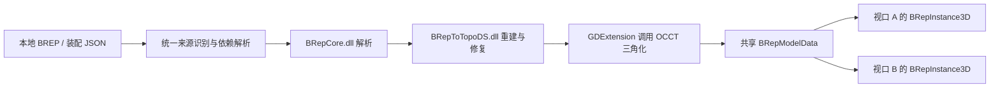

# DigitalViewer BREP 加载方案

状态：已完成 Windows 首版接入，并适配 2026-11-03 的新版 SDK（`a18a8cd`）。已支持源 solid/shell 到多个修复结果的映射，以及 1.3 单位元数据；实际交付和限制见 [BREP 预览版](brep-preview.md)。下文保留完整分阶段设计，不能把所有设计项视为已完成。BREP 解析与拓扑转换均调用现有编译好的 DLL，不重写、不纳入 Godot 源码编译。

## 1. 范围与已有实现

目标是让 DigitalViewer 的 CAD、ALL 配置直接查看 BRepViewer 所使用的 NDS BREP 数据，并接入已有图层、多视口、属性和脚本工作台。

已核对的参考代码位于 `E:/WorkSpace/NDS/GitLab/ndsbrepexpoter`：

| 参考代码 | 已有行为 | 本次复用方式 |
| --- | --- | --- |
| `Source/BRepCore/BRepReader.cpp`、`BRepFile.h` | 读取文件或内存中的 NDS BREP，校验文件头、分区和索引 | 调用 `BRepCore.dll` 的现有解析接口 |
| `Source/BRepCore/BRepParsedData.h` | 保存双精度几何、拓扑引用、persistentId 和单位 | 保留为内核数据 |
| `Source/BRepToTopoDS/` | 恢复曲线曲面、边线面、壳体并进行拓扑修复，提供拓扑查询 | 直接调用 `BRepToTopoDS.dll`，以配套版本接口为准 |
| `Source/BRepViewer/BRepLoader.cpp` | 支持 `.brep` 和包含 `brep.file`、`root` 的 JSON 装配入口 | 参考来源分派；对象树仍调用 `BRepCore.dll` 解析 |
| `Source/BRepViewer/ViewerModelLoader.cpp` | OCCT 三角化、面方向和法线处理、装配矩阵、相同形体网格复用、面索引区间 | 提取与渲染器无关的逻辑 |
| `Source/BRepViewer/ViewerModel.h` | `FaceRenderRange` 将渲染三角形关联到 face/shell/solid | 为拾取和后续高亮保留映射 |

当前格式文件头为 `NDSBREP\0`；最新源码读取器支持主版本 1、次版本 0～3，但已有 DLL 的格式支持范围必须以其配套版本和样例验证为准，不能把最新源码能力直接归到旧 DLL 上。它不是 OpenCascade 常见的文本 `.brep`；两者扩展名相同，首期应按 magic 识别，遇到其他 BREP 方言明确提示。首期不新增 STEP、IGES、DWG 导入、建模或布尔运算。

单独 `.brep` 可恢复几何和拓扑；名称、装配结构、实例矩阵以配套 JSON 为准，不假设二进制文件包含完整装配。现有 JSON 读取没有恢复材质，Viewer 使用默认材质，因此首期采用统一 CAD 默认材质，不承诺源材质还原。

## 2. 推荐架构

新增 `addons/brep/` GDExtension，编译为 `DigitalViewerBRep.dll`，直接链接现有 `BRepCore.lib`、`BRepToTopoDS.lib` 和匹配的 OCCT 导入库。这里 `.lib` 用作 DLL 的导入库，几何实现仍运行于现有 DLL。BREP 能力与 `osgdb`、`3dtiles`、`tiled_mesh_3d` 独立。

适配层只负责读取来源、调用 DLL、调用 OCCT 三角化、提取网格和拓扑映射、注册 Godot 类。BREP 二进制解析、JSON 对象树解析、拓扑重建和修复全部使用既有 DLL。取消上一版新增 `NDSBRepRuntime` 和重新编译 CAD 几何源码的建议，不修改 NDS 现有库。

采用 GDExtension 的原因是现有 DLL 提供 MSVC C++ 接口，包含 STL 容器和 OCCT 类型；这些接口不能由 GDScript 直接调用。现有 Godot 构建为 `/MT`，检查到的 CAD DLL 使用动态 MSVC CRT；扩展可以单独使用匹配的 x64 MSVC 工具链、`/MD`、Release STL 配置和异常处理，Godot 主程序保持原有构建参数。通过 Godot GDExtension 接口传递 Godot 值、资源和节点，STL/OCCT 对象只留在扩展与 CAD DLL 的兼容 C++ 边界内。godot-cpp、适配层与相关 CAD 库的编译配置必须核对一致，不能只改变一个源文件的 `/MD` 参数。

接入的 SDK 是现有构建产物的固定集合：配套头文件、导入 `.lib`、运行时 DLL、版本与 SHA256 清单。通过适配层构建参数 `brep_sdk_path` 指定；DigitalViewer 构建只编译适配层，不自动重编 BRepCore、BRepToTopoDS 或 OCCT。无需引入 WSG、Dawn、GLFW、Python、HOOPS 或用于 STEP 的 OCCT_DataExchange。

### 首版 SDK 的历史核对记录（`7d0af0d`）

以下记录描述首版使用的旧 DLL。2026-11-03 已换用配套的 `a18a8cd` 头文件、导入库和新 DLL；新 DLL 已提供 `getShapeBySourceSolidIndex()`、`sourceShellResultIndices()` 和 `BRepReconstructionOptions`，不再提供旧 `buildCompound()`、`shape()`。`ParsedBRepData` 已增加单位字段，不能与旧 DLL 混用。新 OCCT 运行库位于 `ThirdPart/OCCT/windows/bin/`。当前固定清单见 `addons/brep/native/sdk/manifest.json`。下列旧版缺失接口的结论仅作历史记录。

- 两者均为 Windows x64，导入 `MSVCP140.dll`、`VCRUNTIME140.dll` 等动态运行库。
- `BRepCore.dll` 导出 `BRepFile::parse(path/bytes, ParsedBRepData, error)` 和 `parse(path/bytes, Object, error)`；二进制和对象树均可复用现有解析。
- `BRepToTopoDS.dll` 导出 `convert()`、`solid/shell/face()`、`facePersistentId()`，以及该版本的 `buildCompound()`、`shape()` 等接口。其实际导入表包含 `OCCT_Lite.dll`，未直接导入 BRepCore；适配层仍需 BRepCore 来执行解析。
- 当前 `bin` 和 `bin/RelWithDebInfo` 的 BRepToTopoDS DLL 均未导出最新头文件中的 `getShapeBySourceSolidIndex()`、`sourceShellResultIndices()`，也未见带 `BRepReconstructionOptions` 的构造重载。因此不能直接拿最新头文件接旧 DLL；数据结构布局也必须核对，不能仅以函数名称相同判定 ABI 兼容。

第一步固定这一批 DLL 对应的头文件、导入库和 OCCT 版本，做最小调用验证。装配创建和拓扑查询使用该批 DLL 实际导出的 API，不调用不存在的新接口，不在适配层补写拓扑转换。如果需要新版本能力，由 CAD 库提供一套匹配的已编译 SDK，DigitalViewer 继续以同样方式调用。

运行时至少携带 BRepCore、BRepToTopoDS 及其依赖的 OCCT_Lite；三角化适配层需要的 OCCT_Tools 和其他依赖以链接结果为准。通过 PE 依赖检查生成完整清单，不直接复制整个 NDS `bin`。

建议暴露的 Godot 接口：

| 类型 | 职责 |
| --- | --- |
| `BRepDocument` | 检查格式、启动导入、返回结构化结果和诊断 |
| `BRepImportOptions` | 单位、上方向、三角化精度、内存与三角形预算 |
| `BRepImportTask` | 导入状态、进度、取消请求、错误和结果 |
| `BRepModelData : Resource` | 共享网格、装配描述、源元数据、拓扑映射和必要的内核句柄 |
| `BRepInstance3D : Node3D` | 按资源创建每个视口独立的节点、显示状态、选择和变换 |

`BRepInstance3D` 实现现有查看器可直接调用的 `get_dataset_aabb()`、`intersect_ray()`、`close()`；需要时提供 `set_receive_lighting_mode()`。缓存和引用以 `BRepModelData` 为中心，不依赖普通 Node 的 `duplicate()` 自动复制自定义原生状态。

## 3. 导入流程与数据表达

1. 统一识别来源，读取 `.brep` 或 JSON 及其依赖；校验版本、文件大小、数量和路径。
2. 后台调用 `BRepCore.dll` 的 `BRepFile::parse()` 得到 `ParsedBRepData`，再通过 `BRepToTopoDS.dll` 调用构造函数和 `convert()`。JSON 的 `Object` 树同样通过 BRepCore 解析，适配层只识别入口和定位 `brep.file` 依赖。
3. 使用配套 SDK 已导出的接口获取实际 solid/shell 和装配。当前新版对源 solid 调用 `getShapeBySourceSolidIndex()`，同时取出所有结果实体和独立壳；对源 shell 调用 `sourceShellResultIndices()`。先按源数组校验 `repBodyIndex`，再将全部结果挂到对应 occurrence，并按结果索引复用网格；不假设源索引与结果索引相同。
4. 对唯一形体三角化，生成纯 CPU 顶点、法线、索引、面区间、包围盒及诊断；不从后台线程修改活动 SceneTree。
5. 主线程按预算创建 `ArrayMesh`、材质和装配节点；分帧提交大模型，完成后发布共享资源和图层实例。

现有 `_jobs` 只处理 glTF，结果固定依赖 `document/state`。应抽象为具有任务类型、generation、结果和取消状态的导入任务，避免 BREP 结果进入 glTF 的场景生成分支。

状态建议为 `Queued → Parsing → Reconstructing → Tessellating → Uploading → Ready`，同时支持 `Cancelled / Failed`。删除、重载或退出后旧 generation 的结果不能写回。取消采用协作方式：阶段之间及 body/face 批次检查；OCCT 单次不可中断调用结束前不承诺立即取消，也不强制终止线程。

资源和场景按以下方式组织：

- 一个数据源共享一份 `BRepModelData`；重复零件复用形体网格，每个 occurrence 有独立装配变换。
- 场景为装配节点、零件节点、实体/壳网格节点；不为每个 face 创建一个 MeshInstance3D 或 surface。每个 body 默认一个或少量 surface，面选择通过索引区间实现。
- 首期保留 face/shell/solid、persistentId、源对象 ID、occurrence 路径和三角形范围。重载前后的身份不能只靠三角形编号或单个 persistentId；需要数据版本和实例路径共同定位。
- 内核双精度数据和原始拓扑不受视口显隐、透明度、选择、高亮或手动变换影响。

## 4. 几何正确性

**三角化。** 参考 Viewer 当前“包围盒对角线 × 1e-3，夹紧到 1e-4～1，角度 0.4 rad”的策略，但其夹紧值处于源坐标单位；接入后应按明确的单位策略解释阈值，提供粗/标准/精细预设，不直接把源单位常量当作毫米。

正确处理裁剪边界、孔洞、周期曲面接缝、退化边、`TopLoc_Location`、反向 face 的法线和索引，以及 Godot 的正面绕序。法线使用正确的逆转置变换；镜像和非均匀缩放单独验证。沿用已有拓扑修复，不另加没有验证的删面策略。部分 body/face 无三角形应显示缺失数量与警告；没有可显示几何时失败，不把缺面结果无提示标记为完整成功。

**单位。** 当前配套 SDK 已提供 `unitToMillimeters` 表示每坐标单位的毫米数，仅是元数据；当前 NDS 文件不自动缩放。本版已读取该字段并在属性中显示；旧夹具和 1.3 英寸夹具均已回归。默认保留源坐标，脚本/API 可用根节点 `unit_scale` 统一缩放。OCCT 重建和修复保持该 DLL 原有行为；显示层提供统一转换，已知单位可转换为米，几何与装配平移只能转换一次。未提供单位或值为 0 时保留坐标单位并显示“未知”，允许用户显式指定，不能默认为毫米。长度、面积和体积换算分别使用一次、二次、三次比例。

**坐标与精度。** 提供源上方向选项，在数据根节点统一转换到 Godot Y-up，不逐 body 重复变换。保留源坐标、原点与转换参数。大坐标模型先在 double 中完成装配计算和必要的局部原点偏移，再交给浮点渲染；多文件组合必须采用共同原点，不能每个零件分别归零破坏装配关系。首期以约定的数据尺寸和坐标范围验收，不声称单次归零即可解决所有超大装配精度问题。

## 5. DigitalViewer 接入点

| 文件/区域 | 计划修改 |
| --- | --- |
| 新增 `addons/brep/` 及扩展构建目标 | 用 godot-cpp 注册接口，链接现有 CAD DLL 导入库；提供 `.gdextension` 与平台依赖声明 |
| `scripts/desktop/data_store.gd` | 增加 `brep` 数据类型、异步任务、共享资源实例化、生命周期及诊断 |
| 新增 `scripts/desktop/source_resolver.gd` | 统一 local/ZIP/remote 来源识别和依赖解析，避免多个入口各写扩展名规则 |
| `scripts/desktop/build_profile.gd` | 增加 brep 能力与原生类检查；修改 JSON 的功能判定 |
| `scripts/desktop/shell.gd` | 文件过滤、拖入/目录/ZIP 入口、单位与上方向选项、CAD 属性 |
| `scripts/desktop/session.gd` | 共享 BREP 资源与独立视口实例、API 摘要与元数据 |
| `scripts/desktop/view_scene.gd` | 接入原生包围盒和射线拾取；将三角形命中映射到 CAD 对象/面 |
| `scripts/desktop/pane.gd`、`viewport_tree.gd` | 装配层级、零件名称和实体类型的展示 |
| `profiles/CAD.json`、`profiles/ALL.json` | 两者均增加 `"brep": true`，其他能力不变 |
| `tools/Profile-Common.ps1`、扩展构建脚本 | 校验 brep 能力字段、SDK 版本和适配层构建选项；引擎模板不增加 `module_brep_enabled` |
| `tools/Build-Desktop.ps1`、导出配置 | 暂存工程包含 addons；配置 `.gdextension` 和 DLL 导出依赖，复制运行库、许可证、版本清单并加入 ZIP/散列 |

必须修正 JSON 分派：当前 `data_store.gd` 把所有 `.json` 判为 tiled，`build_profile.gd` 又把 `.json` 直接归入 3dtiles，导致 CAD 无法打开装配 JSON。应先识别内容，再执行相应的能力检查：

- 符合 `brep.file + root` 结构：BREP 装配入口。
- 符合 3D Tiles 结构：瓦片入口。
- 无法识别或存在冲突：返回明确错误，不能回落为另一种格式。

识别只读取数据，不执行脚本；远程 JSON 在受控下载后分派。ZIP 也使用同一规则，已识别为装配入口的 JSON 应覆盖其引用的 `.brep`，避免把同一个模型列为两个独立候选。

首期本地 JSON 默认只允许模型目录中的相对依赖；后续 ZIP 限制在解压根目录，远程限制为允许的相对来源并沿用已有同源凭据规则。文件数、JSON 深度、展开字节数、拓扑实体数、网格内存和三角形总数均需预算，不能只沿用 glTF 的 64 MiB 文件上限推断 CAD 重建内存。

## 6. 分阶段交付

| 阶段 | 交付内容 | 验收标准 |
| --- | --- | --- |
| 1：DLL 接通 | 固定已有 DLL/头文件/导入库，构建薄 GDExtension；本地 `.brep`/装配 JSON、线程任务、基础显示、图层、多视口及 CAD/ALL 打包 | DLL 不重编；最小解析/转换/释放通过；盒体、带孔曲面、开壳、重复实例和中文路径正确；干净机器可运行 |
| 2：CAD 查看 | 对象/面拾取与高亮、装配树、源 ID/单位/统计属性、精度选项、较大模型分帧提交 | 命中能映射回源对象/面；嵌套/镜像实例、隐藏和非均匀缩放正确；与 BRepViewer 对照无无提示缺面 |
| 3：来源扩展 | ZIP 和远程 `.brep`/装配 JSON、依赖缓存、下载进度和取消 | 同源凭据、相对路径、歧义入口、解压及内存预算、删除/重载取消均通过 |

阶段 1 即保留后续面选择所需映射和原始元数据，避免之后重做导入格式。纯 wire/孤立 edge 在阶段 1 明确提示；需要曲线显示时增加离散化线网格，不假设 BRepViewer 当前的三角网格链路已经支持它们。

## 7. 测试与发布门槛

- DLL 接入：导出符号、头文件结构、工具链/CRT/迭代器配置匹配；既有解析/转换/释放流程通过，缺失依赖能定位；不将最新源码能力当作旧 DLL 已支持能力。
- 解析：覆盖所选 DLL 实际支持的格式版本、非法 magic/版本、截断和非法索引；装配 JSON 缺依赖、越界 body 索引和过深层级。校验仍由现有解析器承担。
- 几何：平面孔洞、圆柱/圆锥/球/环面、BSpline、接缝、反向面、开壳和修复后实体拆分；源面到网格映射完整。
- 装配：嵌套变换、同零件多实例、镜像、非均匀缩放；包围盒和拾取使用正确的 occurrence 变换。
- 单位：毫米/米/英寸、旧文件未知单位；几何、平移、修复容差和面积/体积无重复转换。
- 生命周期：后台加载时删除/重载、多个视口共享、关闭最后引用、退出等待任务结束；监测 CPU/GPU 和内核句柄释放。
- 配置：CAD、ALL 均可加载 BREP；CAD 仍无 OSG/3D Tiles/GIS；扩展缺失或 SDK 版本错误提供明确提示。
- 发布：从固定 SDK 清单复制运行库，校验全部 DLL 依赖和散列，随包携带适用许可证；无需依赖开发机 PATH、NDS 仓库或 HOOPS 安装。

对照 BRepViewer 比较装配、包围盒、可显示 body/face 覆盖、体积/面积及拾取映射，不仅比较截图。重建完成不等于拓扑有效，原始/修复后的测量和警告应分别标识。性能和内存门槛在约定代表模型与基准机器后设定，不提前给出无实测依据的秒数。
