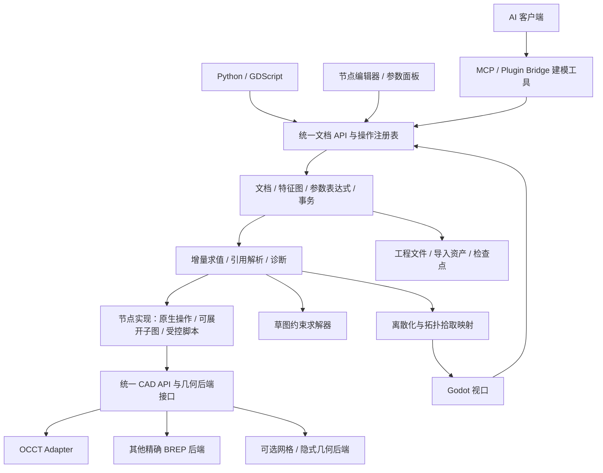

# 可替换几何内核的 CAD 建模平台实现方案

日期：2026-11-10。状态：设计建议，尚未实现；文中的新 API、目录、工具名称均为拟议接口。

开发顺序、模块交付、前置依赖和逐步验收见 [完整实施步骤](cad-modeling-implementation-plan.md)。

已确认需求：核心目标是 AI 能有效建模，生成的建模过程和结果可由人继续修改，并能复用。首期同时覆盖机械零件参数化建模与曲线曲面建模；支持脚本与节点交互；首个后端使用 OCCT，并允许接入其他几何引擎。

## 1. 推荐架构与范围

建设独立的 C++ 建模核心，以“可编辑、可执行的设计文档 + 统一特征图 + 可复用组件”为中心。AI 和人通过同一文档命令层创建和修改设计；节点图、特征树、参数面板和草图编辑器是同一文档的不同交互视图。Godot 承担交互与显示，OCCT 承担第一个后端的几何计算。

节点执行支持原生操作、可展开子图和受控脚本三种实现。脚本既能通过文档 API 批量创建可编辑特征，也能实现具有明确边界的算法节点；不强制所有基础操作经过脚本层。AI 通过结构化 API 编辑节点图，无需模拟鼠标拖拽。

首期目标是工程可用的机械和曲面建模基础平台。完整钣金展开、装配约束、工程制图、CAM、逆向工程、任意模型的自动特征识别及完整 A 级曲面工具另行规划。它们可以成为后续功能包，不能仅凭“支持 OCC”就视为已具备。



图中的依赖方向是单向分层；视口回到 API 的箭头仅表示用户操作。建模核心不依赖 Godot、Python 或某个 AI SDK。草图求解器独立于几何内核，约束迭代封装在草图节点内部。

### 1.1 产品成功标准：AI 生成、人接手、继续复用

每次 AI 建模交付应包含：精确几何结果、可编辑的参数/草图/特征依赖、设计约束及假设、版本化依赖和可验证的结果。可复用时另外发布组件接口、适用参数范围与样例。代码或操作日志本身不能证明过程可编辑。

人的编辑入口应匹配任务：尺寸用参数面板，轮廓用草图编辑器，曲面用截面/导轨/控制点编辑器，步骤用特征树，依赖关系用节点图。用户不必为了修改孔径而进入复杂节点图。

图中的节点以可理解的设计特征为粒度，例如草图、拉伸、孔、阵列、圆角、放样、裁剪和缝合；内核内部的数值算法步骤留在实现层。长流程按部件和建模目的组织成可展开子图，保留有意义的名称、参数单位、来源和关键中间结果。

首个验收闭环即为：AI 创建模型 → 人修改参数和一个局部特征 → AI 基于修改后的版本继续建模 → 封装子图 → 在另一工程实例化。只验证初次生成几何不算完成目标。

## 2. 现有工程可复用的基础

本方案根据当前工作区的源码和文档制定，未运行构建或几何验收。

| 现有部分 | 已观察到的能力 | 在新架构中的位置 |
| --- | --- | --- |
| `ndsbrepexpoter/Source/BRepCore` | NDS BREP、装配定义、离散数据与文件读写 | 导入资产、交换格式、旧模型兼容 |
| `ndsbrepexpoter/Source/BRepToTopoDS` | OCC 重建、修复、源对象到结果拓扑的关联 | OCCT 导入适配器与导入来源记录 |
| `ndsbrepexpoter/ThirdPart/OCCT/OCCT_Lite/CMakeLists.txt` | 配置包含 TKPrim、TKBO、TKBool、TKFillet、TKOffset、TKFeat、TKMesh 等工具包 | 首个几何后端的依赖基础；实际链接与功能需专项验证 |
| `DigitalViewer/addons/brep/native/brep_document.cpp` | BREP 导入、OCC 离散化、源/重构面 JSON、内核串行访问 | 保留旧查看流程，逐步复用显示与选择适配 |
| DigitalViewer 桌面层 | 多视口、结构树、面高亮、GDScript 工作台 | 建模交互和脚本入口 |
| DigitalViewer 自动化层 | MCP / Plugin Bridge 共享工具分发与权限模型 | 新增结构化建模工具的传输入口 |

现有 `BRepDocument` 主要是导入显示对象。新增 `CadDocument` 管理可编辑特征和事务，避免把所有建模能力继续塞入导入类。现有 `facePersistentId` 和源索引映射可作为导入来源信息，但不能直接承担任意建模操作后的拓扑持久命名。

当前自动化实现的 `script.run` 返回 `manual_run_required`。AI 自动建模需要新增受控的文档操作工具；现有入口不能被描述为已经支持自动建模。

现有工程对修复容差、原始坐标和显示缩放已有约定。新建模模块明确自己的单位和容差政策，通过适配器转换，不全局改写旧导入器行为。

## 3. 建模数据分三层

| 层 | 内容 | 生命周期和职责 |
| --- | --- | --- |
| 设计意图 | 参数、表达式、草图约束、特征节点、连接、选择规则 | 工程主数据，版本化保存，可编辑、可回放 |
| 几何结果 | 曲线、曲面、拓扑、内核原生对象 | 按文档版本生成的结果；原生缓存按后端及版本绑定 |
| 显示数据 | 三角网格、线段、法线、LOD、拾取映射 | 可丢弃并重新生成的缓存 |

导入件没有平台特征历史时，保存不可变的原始精确几何资产，用 `ImportFeature` 引用。导入资产是该节点的输入主数据；不能假定所有几何结果都能从平台特征重建，也不能依赖用户原文件一直存在。

不要从 Godot 网格反推精确几何。网格显示结果也不作为布尔、测量或曲面质量检查的精确依据。

### 3.1 公共类型

- 数值：`Length`、`Angle`、`Scalar`、`Integer`、`Bool`，禁止长度与角度的隐式混用。
- 基准：`Point2/3`、`Direction3`、`Vector3`、`Plane`、`Axis`、`Frame`、`Transform`。
- 几何：`Curve2D`、`Curve3D`、`Surface`；曲面本身与被边界裁剪的面区分。
- 拓扑：`Vertex`、`Edge`、`Wire`、`Face`、`Shell`、`Solid`、`Compound`。
- 建模：`Sketch`、`Profile`、`Feature`、`Body`、`Part`、`AssemblyInstance`。
- 引用：`FeatureRef`、`OutputRef`、`SelectionRef`、`AssetRef`。

Body 可代表线体、曲面体或实体；类型由明确的结果类型描述。开放壳不能通过命名或强制转换被当作实体。布尔运算支持返回多个体或空结果，输出基数与空结果政策必须在操作定义中声明。

### 3.2 标识与数值约定

- `DocumentId / FeatureId / AssetId` 使用稳定 ID；`FeatureId + output_port` 标识逻辑输出。
- 几何句柄包含所属内核上下文和版本，进程内有效；禁止将裸指针、遍历索引或运行时句柄写入工程文件。
- `SelectionRef` 保存设计引用及其解析条件；当前 `SubshapeId` 只对应某次求值的拓扑。
- CAD 核心使用双精度。建议新文档内部长度统一为 mm、角度为 rad，显示单位可独立设置，表达式执行量纲检查。
- 导入时显式换算几何、变换平移与容差，并记录源单位；未知单位进入待解析状态，由调用方提供单位，不猜测。
- 使用右手坐标系、明确矩阵布局与轴方向。模型局部坐标与 Godot 显示坐标分离，大坐标通过显示原点变换处理。
- 分开保存计算精度、拓扑容差、允许的修复偏差、显示弦差。修复必须报告几何改变量；不能用放大容差掩盖建模失败。

## 4. 操作注册表：三种入口共享的契约

每个操作拥有唯一 ID 和语义版本，如 `solid.extrude@1`、`surface.loft@1`。注册内容包括输入/输出类型、单位、基数、默认值、取值约束、跨参数校验、需要的后端能力、求值器、迁移器、帮助和错误码。

示意定义：

```json
{
  "operation": "solid.extrude",
  "version": 1,
  "inputs": {
    "profile": {"type": "Profile", "closed": true, "planar": true},
    "direction": {"type": "Direction3"},
    "distance": {"type": "Length", "exclusiveMinimum": 0}
  },
  "outputs": {"body": {"type": "Solid"}},
  "requires": ["brep.extrude_solid"],
  "errors": ["OPEN_PROFILE", "SELF_INTERSECTION", "INVALID_RESULT"]
}
```

以上为领域 schema 示意；实现时将类型、量纲等扩展编译为内部强类型描述，并生成适用于 JSON Schema 的外部参数定义。`closed`、`planar` 等几何条件由求值阶段检查。

同一注册表生成脚本包装、参数表单、节点端口、AI 工具参数说明及文档骨架。草图编辑器、曲线控制点编辑器等复杂交互需要专用 UI，不能仅靠 schema 自动生成完整产品。

文档 API 负责 `create_feature / set_parameter / connect / suppress / remove / preview / commit / undo / redo`；查询 API 负责结构、测量、拓扑、选择与诊断；几何 API 负责具体计算。三者职责明确，但共享类型和诊断格式。

## 5. 几何后端接口与可替换边界

### 5.1 C++ 内部接口

```cpp
// 设计示意。请求是强类型的操作联合体，不把未验证 JSON 直接交给内核。
class IGeometryBackend {
public:
    virtual ~IGeometryBackend() = default;
    virtual BackendDescriptor descriptor() const = 0;
    virtual CapabilitySet capabilities() const = 0;
    virtual Result<KernelResult> evaluate(
        KernelContext&, const KernelRequest&, EvaluationControl&) = 0;
    virtual Result<QueryResult> query(
        KernelContext&, const GeometryQuery&) = 0;
    virtual Result<MeshPacket> tessellate(
        KernelContext&, const TessellationRequest&, EvaluationControl&) = 0;
};
```

能力域按曲线、曲面、拓扑、实体运算、查询、检查、离散化拆分注册，避免演变为一个强制实现几百个虚函数的大接口。高层特征求值器可组合多个底层几何操作。

`KernelResult` 至少携带结果类型、几何句柄、有效性报告、操作历史、警告、实际精度/偏差和后端信息。适配器负责把 OCCT 异常及状态翻译成公共错误，公共头文件不暴露 `TopoDS_Shape`、`gp_Pnt` 或 Godot `Variant`。

### 5.2 插件 ABI 与生命周期

C++ 接口用于内部开发。独立发布的动态插件使用版本化 C ABI：函数表、固定宽度类型、显式长度的缓冲区和不透明句柄；对象由创建它的模块释放，不跨 DLL 传 STL 容器或异常。

描述符记录 `backend_id / backend_version / abi_version / capabilities`。在文档关闭、任务取消或 worker 重启后，旧句柄必须失效。内核结果采用受管理的不可变快照；可能修改形体的算法，包括某些离散化与修复过程，在专属副本或受控上下文中运行，避免污染缓存和撤销历史。

### 5.3 多后端行为

| 能力状态 | 行为 |
| --- | --- |
| 原生支持 | 直接执行，记录使用的后端和算法版本 |
| 组合实现 | 使用已定义的等价操作组合，记录展开版本 |
| 近似实现 | 调用方显式允许，结果标明表示类型、误差与限制 |
| 不支持 | 返回 `UNSUPPORTED_CAPABILITY`，包含可选替代方案 |

精确 BREP、三角网格、隐式场属于不同表示类型。网格布尔后端可成为扩展，但不能用于证明精确 BREP 后端可替换，也不能静默代替精确实体运算。

同一次运算的输入必须属于兼容的内核上下文。第一版建议一份文档固定一个精确几何后端；将来允许按 Body 指定后端时，跨后端转换仍是显式操作。

后端切换分两种：

1. **特征重放**：目标后端支持整条特征链时，在新分支重新求值并比较几何及约束；不承诺拓扑编号或完全相同的数值结果。
2. **几何转移**：通过 STEP 或已验证的精确交换适配器导入几何快照，保存来源；不能保证保留平台特征历史和原有子形体引用。

首个后端使用 OCCT。第二个精确 BREP 后端可从 Parasolid、ACIS、C3D 等候选中结合可获得 SDK、部署条件和功能需求选择。必须用一个真实的第二后端完成基本建模契约验收；mock 只能验证接口调用，不能证明几何语义可移植。

## 6. 参数化特征图和求值

工程的主表达采用带类型的有向无环图。特征树是图的顺序视图，节点编辑器是图的连线视图。Body 中的历史特征通过输出依赖前序结果；部件与装配实例属于文档结构，和特征依赖图区分。

节点记录 `id / operation / version / inputs / parameters / expression / metadata`。参数表达式用受限制的表达式 AST 表示，不能把任意 Python 源码当作必须重放的模型主数据。

执行过程：检查 schema 与单位 → 解析引用 → 检查循环依赖 → 计算脏节点 → 调用后端 → 检查结果及约束 → 更新引用历史 → 生成显示缓存 → 发布文档版本。

- 每次编辑创建草稿，按受影响子图增量计算。草稿失败时保留错误节点；当前正式版本保持可用。
- 提交以事务为单位，检查 `base_revision`，将图、几何和选择映射原子发布为新 revision。
- 并发写入按文档串行化；客户端使用 revision 冲突检测。网络重试用 `request_id` 幂等去重，避免重复创建特征。
- 撤销/重做恢复模型语义、参数及版本映射，不只是隐藏/显示网格。缓存可复用但不能决定正确性。
- 旧任务晚到的结果按 revision 丢弃；视口中的过期拾取也不能直接作用于新模型。
- 缓存键包含操作语义版本、参数、输入结果指纹、选择解析结果、容差、后端及版本；显示缓存另外包含离散化配置。
- 草图约束等循环关系由独立求解节点处理。通用特征图拒绝依赖环。
- 数组明确区分标量、列表、`map / zip / product`；改变阵列数量时通过阵列特征表达，避免依赖一次脚本运行时展开的固定节点数。

Python 中的普通循环、条件分支只保证在执行时生成对应的图；任意源代码与节点图之间不承诺无损双向转换。可输出规范化脚本帮助阅读和重建，但不能宣称恢复用户原始程序。

## 7. 机械与曲面功能作为首期的两条主线

| 领域 | 首期可用能力 | 后续增强 |
| --- | --- | --- |
| 基准与参数 | 点、轴、平面、坐标系、表达式、单位 | 参数表与设计族 |
| 草图 | 线段、圆、圆弧；重合、水平/垂直、平行、垂直、相切、尺寸、等长；欠约束/过约束诊断 | 更复杂样条约束、大规模求解优化 |
| 基础实体 | 长方体、圆柱、圆锥、球、圆环；拉伸、旋转 | 特定行业特征 |
| 实体修改 | 并/差/交、分割、孔、恒定半径圆角、倒角、镜像、阵列 | 变半径圆角、复杂拔模、抽壳增强 |
| 曲线 | 解析曲线、插值/控制点 B-spline 与 NURBS、裁剪、连接、投影、曲面求交线 | 高级拟合、曲率优化 |
| 曲面 | 解析面、NURBS 定义、放样、扫掠、旋转/拉伸曲面、基础补面 | 更复杂多导轨与边界条件、专用曲面造型 |
| 曲面编辑 | 曲面裁剪、延伸、偏移、缝合、封闭成体、受限加厚；G0/G1 检查与基础连接 | G2 构造与更全面连续性优化、A 级曲面工具 |
| 质量与交换 | 长度/面积/体积、距离、实体有效性、自由边、缝隙、法向/曲率分析；STEP 导入导出 | 高级修复、更多格式、批量质量报告 |

“首期可用”必须按验收模型限定支持范围。圆角、偏移、加厚、扫掠和缝合都有几何退化与自交失败场景，接口需要稳定报告失败，不能承诺任意输入成功。

### 7.1 草图求解器

OCCT 的几何算法不等于完整的参数化草图约束系统。新增 `ISketchSolver` 接口，先评估成熟求解器，例如 SolveSpace 的求解能力或可获得的商业方案；结合功能、可嵌入性、许可与稳定性选择，避免首期自行开发完整非线性约束求解器。

草图具有局部二维坐标系、稳定实体 ID、约束集合及求解状态。返回剩余自由度、冲突约束、残差和失败原因。求解之后再生成线框或闭合轮廓，并检查孔洞、方向、闭合和自交。

### 7.2 曲面接口必须表达设计条件

放样和扫掠的公共参数需要明确：截面顺序、闭合轮廓接缝对应、导轨、路径方向、截面坐标架、扭转策略、端部条件，以及输出曲面体还是实体。

NURBS 定义保存次数、节点、重数、权重、参数域及周期性。拓扑适配器负责曲面上的二维边界曲线、缝边、退化边和方向关系。平台提供这些信息的查询和诊断，常规调用方不必手动拼装内核拓扑。

G0/G1/G2 是几何连续性要求，与 C0/C1/C2 参数连续性区分；“要求某级连续性”和“事后测得达到某级连续性”也区分。不能把一个 `smooth=true` 参数视为连续性保证。后端不支持指定边界条件时应明确拒绝。

缝合返回壳与自由边等诊断；只有闭合、方向一致、满足有效性要求的壳才能构造成实体。加厚必须检查偏移自交、边界封口和最终实体有效性。

## 8. 拓扑引用是核心基础设施

禁止使用 `faces[3]`、`edges[7]` 作为持久参数引用。添加 UUID 本身不能解决模型变化后面/边发生分裂、合并或消失的问题。

推荐引用解析顺序：

1. 特征语义：例如拉伸特征的终止端面、由某个草图边生成的侧面、指定孔的圆柱面。
2. 操作历史：由后端返回 Generated / Modified / Deleted 等映射；平台保存一对多、多对一和删除关系。
3. 几何与邻接条件：曲面类别、法向、位置、面积、长度、相邻面等组合约束，用作辅助定位。
4. 仍有歧义时返回 `AMBIGUOUS_SELECTION` 或 `BROKEN_REFERENCE`，交给用户或上层策略重新指定；不能静默选择“看起来最近”的面。

选择规则带结果类型和基数，如 `exactly_one` 或 `all_matching`。实际匹配结果可以是一个、多个、零个或歧义，求值器按契约处理。对未能提供可靠历史的后端操作，显式标注引用追踪质量。

优先用基准平面和轴定义设计意图，减少对容易变化的结果面依赖。复杂布尔、内核升级和跨内核重建都可能破坏引用，不承诺完全自动修复。

显示拾取记录 `document_revision + body/output + subshape + instance_path`，再转换为持久选择规则。面三角形、边折线及装配实例分别映射，保证共享几何的多个实例不会选错对象。

## 9. 脚本接口

核心 C++20；Python 作为通用自动化 SDK，可用 pybind11 绑定同构建环境的核心 facade，独立 worker 模式通过相同命令协议访问。GDScript 通过 GDExtension 暴露精简 facade，复用现有工作台。文档层脚本创建公共特征，不直接暴露 OCC 对象。

区分两类脚本：**图构建脚本**执行后生成显式特征和子图，之后由特征图作为主数据，人修改图后不能再无条件重跑旧脚本覆盖修改；**算法节点脚本**作为版本化节点实现，输入依赖、输出类型和资源限制明确，内部逻辑通过源码与诊断查看，不承诺自动转换成可视化子图。普通建模步骤优先用原生特征或可展开子图，脚本节点用于曲线拟合、截面生成等特定算法。

下面是目标接口示意，并非当前可运行代码：

```python
doc = cad.document(backend="occt", length_unit="mm")
with doc.edit("创建安装板") as edit:
    width = edit.parameter("width", cad.mm(100))
    height = edit.parameter("height", cad.mm(60))
    thickness = edit.parameter("thickness", cad.mm(10))

    # rectangle 内部建立带尺寸约束、固定到原点的草图。
    sketch = edit.sketch(plane=edit.datum.xy)
    profile = sketch.rectangle(origin=(0, 0), width=width, height=height)
    plate = edit.solid.extrude(profile, direction=(0, 0, 1), distance=thickness)
    tool = edit.solid.cylinder(
        origin=(width / 2, height / 2, -cad.mm(1)),
        axis=(0, 0, 1), radius=cad.mm(5), height=thickness + cad.mm(2))
    drilled = edit.solid.cut(plate, tool)
    edit.publish(drilled, name="mounting_plate")
    edit.commit()  # 求值、检查并原子发布；失败则不发布。
```

`width / 2` 等表达式在此 SDK 中构建参数表达式节点，不能立即退化成普通数值。修改 width 时，下游几何和孔位置一起更新。

曲面调用示意：

```python
with doc.edit("创建曲面外壳") as edit:
    c1 = edit.curve.bspline(points=section_1, degree=3)
    c2 = edit.curve.bspline(points=section_2, degree=3)
    c3 = edit.curve.bspline(points=section_3, degree=3)
    skin = edit.surface.loft(sections=[c1, c2, c3], alignment="explicit")
    trimmed = edit.surface.trim(skin, boundaries=trim_loops)
    shell = edit.topology.sew(faces=[trimmed], tolerance=cad.mm(0.01))
    body = edit.solid.thicken(shell, thickness=cad.mm(2), side="positive")
    edit.publish(body, name="curved_cover")
    edit.commit()
```

上述曲面示例的截面对应关系、合法裁剪环和加厚可行性是输入前提；生产接口需要提供对应参数并报告失败。`surface.loft` 的平台输出包装为具有边界的曲面体，底层裸 Surface 与 Face 仍按类型区分。

## 10. 节点建模

Godot `GraphEdit / GraphNode` 可用于首个节点编辑器，需验证大图性能。节点编辑器只编辑同一个特征图，不生成另一套独立执行语义。

- schema 决定端口类型、单位与可连接关系；几何预览和空间选择使用专用控件。
- 支持参数节点、曲线/曲面节点、实体操作节点、选择节点、测量节点及子图组件。
- 草图在专用二维编辑器中编辑，在图中表现为一个有明确输入输出的节点。
- 拖动参数时合并更新、取消过时任务并降低显示离散精度；正式提交使用正式参数与验证策略。
- 大图按 Body、Part 和可复用子图分组；面板修改、脚本 API 修改与节点修改都发出相同文档命令。
- 批量连接与删除可作为一个事务撤销；节点布局、颜色、展开状态属于 UI 元数据，不能参与几何计算缓存键。

### 10.1 修改过程与修改结果

修改过程支持改参数、改约束、替换输入、插入/抑制/替换特征、修改截面与导轨。每项操作都返回受影响特征和引用诊断，并支持查看关键中间结果。

修改结果时，三维拾取通过拓扑来源映射定位相关特征。若拖动行为能明确映射到某个尺寸或控制点，就生成参数/控制点编辑；若无法唯一映射，显示候选或添加后端支持的显式直接编辑特征，例如移动面、偏移面、删面补面。直接编辑也进入历史、参与依赖求值和撤销，不能只修改显示网格或偷偷覆盖几何快照。

三维操作不保证总能反推原始设计参数。复杂结果可能对应多个上游特征；直接编辑的成功范围和引用稳定性需按后端验证，不能承诺任意面可自由拖动。

### 10.2 复用组件

复用以版本化子图组件为主，提供明确的输入参数、单位、取值范围、几何输入、命名输出、基准坐标系、设计约束和验证样例。组件不得隐式依赖原工程的节点 ID、世界坐标或外部文件；导入资产随组件保存或通过声明的依赖解析。

例如“安装法兰”组件公开外径、厚度、中心孔径、安装孔阵列、安装面与轴线，内部仍可展开查看。阵列节点使用稳定的实例键，并允许记录单个实例的抑制/替换；实例被删除时明确处理对应覆盖项。这样“第三个孔改成长圆孔”能够表达为局部覆盖或子图变体，而无需改写所有实例的定义。

区分组件定义和组件实例：参数覆盖仅影响当前实例；结构修改可创建本地变体或分叉组件；修改共享定义需显示受影响实例。实例固定组件版本，升级先预览差异和验证结果，不静默改变已有模型。

复用分为三个层次：复用同一零件的多个实例、用参数生成尺寸变体、把局部建模方法封装成子图组件。算法脚本也可复用，但其内部只能保证源码层编辑；参数化复用的有效范围需要用样例验证，不能从一个成功模型推断任意参数均可行。

## 11. AI 控制建模

AI 作为模型文档客户端，通过结构化工具控制特征和参数。先读取文档及能力，再提出图修改、预览、查看诊断、修正并提交。无需为不同模型供应商实现不同几何逻辑。

AI 优先检索已有组件、节点定义和经过验证的样例，生成带名称与分组的特征图。设计意图应尽量表达为约束，例如“孔位于板中心”“壁厚一致”，而不是只写死当前坐标；尚未确认的假设单独记录。既要验证几何正确，也要验证预期修改是否可行。

### 11.1 人与 AI 交替编辑

AI 每次从当前已提交 revision 开始工作，读取人的最新修改，提交局部图补丁，并预览新增、修改、删除的特征和受影响结果。默认保留无关特征及稳定 ID，避免每轮重新生成整份模型而丢失人的修改。

记录作者/来源、修改历史、参数保护状态和用户指定的设计约束。保护应区分“不能改参数或节点定义”和“不能改变最终几何性质”：锁定节点参数不会阻止上游变化影响其输出，最终几何要求必须另设可执行约束。AI 补丁需要改变受保护设计或破坏要求时，明确显示冲突，不能静默覆盖。

人改变模型后，旧的 AI 草稿通过 revision 冲突检查拒绝提交，重新基于新版本规划。无冲突编辑不增加额外确认步骤；按已授予的会话策略预览或自动提交。组件实例覆盖、局部变体和人手工插入的特征都属于正式文档数据，后续 AI 必须读取并保留其语义。

### 11.2 结构化工具

建议提供以下工具族；具体发布名称根据传输协议约束映射：

| 工具 | 用途 |
| --- | --- |
| `cad.capabilities / cad.operation.describe` | 查询后端能力和操作 schema |
| `cad.document.describe` | 获取参数、特征、几何摘要及 revision |
| `cad.selection.query / cad.measure` | 定位几何、读取精确测量 |
| `cad.edit.propose` | 根据 base_revision 提交结构化变更，返回 draft_id |
| `cad.edit.preview / cad.job.get / cad.job.cancel` | 执行草稿、查询任务、取消计算 |
| `cad.edit.validate` | 检查几何有效性及用户要求 |
| `cad.edit.commit / cad.edit.discard` | 按权限提交已验证草稿或丢弃 |
| `cad.document.undo / cad.export` | 撤销和导出受支持格式 |
| `cad.component.search / cad.component.describe` | 检索可复用组件、接口、版本和验证范围 |
| `cad.component.extract / cad.component.instantiate` | 提取子图并创建组件实例；提取前检查显式依赖 |

提交请求带 `base_revision`、`draft_id`、预览结果指纹及 `request_id`，确保提交的是被检查过的版本。AI 获得结构化错误、相关特征、可选选择候选和测量结果，截图仅作为辅助反馈。

用户需求可转成验收断言，例如：实体数为 1、宽度 100 mm、厚度 10 mm、孔径 10 mm、曲面最大接缝偏差小于指定值。断言绑定到稳定设计特征和准确几何查询，不能只检查“工具返回成功”。

在现有 MCP/Bridge 工具分发器旁新增 CAD 工具和 `cad.read / cad.edit / cad.export` 权限。提供“仅草稿”“预览后提交”“本会话允许自动建模”等产品策略，允许已授权会话连续操作；模型编辑与任意代码执行是不同权限。

不将模型文本经 `eval/exec` 直接执行为默认 AI 路径。确有自定义算法需要脚本时，把它作为独立执行类型，使用进程隔离与资源限额，并产出可检查的图和几何结果。当前 GDScript 工作台不是可靠的强制终止沙箱。

## 12. 进程、任务与持久化

### 12.1 任务执行

开发验证可以进程内运行，但从一开始通过 `ModelingExecutor` 抽象提交任务。面向自动化的正式版本建议采用独立 `cad-worker`：UI 与编排层在主进程，内核计算在 worker 中。

第一版每个内核上下文串行执行；多文档可分配独立 worker，是否进一步并行由后端能力和测试结果决定。部分内核调用无法即时协作取消，硬超时通过结束对应 worker 实现，不能强杀持锁线程。失败后从已提交检查点恢复，草稿失败不覆盖正式文档。

进程间传递命令、版本、诊断与几何标识；大网格使用受控二进制缓冲或共享内存。导出操作显式写入选定目标；预览/求值本身不产生不可追踪的外部副作用。

### 12.2 工程格式

建议使用带 schema_version 的工程容器，初期可采用 ZIP + JSON + 二进制资源：

```text
project.cadproj
  manifest.json       文档版本、单位、后端与依赖版本
  document.json       参数、特征图、对象层级、选择规则
  assets/             导入的精确几何与引用资产
  checkpoints/        可选内核快照，绑定后端版本
  mesh-cache/         可丢弃的显示缓存
  ui.json             节点布局、视口等 UI 状态
```

保存采用临时文件与原子替换，失败保持旧工程。操作版本、表达式版本、格式迁移和依赖资产校验应在首期建立。保存内核版本及算法选项可增强可复现性，但不承诺跨内核、跨版本逐位一致。

STEP 是几何交换格式，不能替代平台工程格式保存全部参数化设计意图。NDS BREP 可继续承担现有导入/显示资产；是否作为跨内核交换格式，需先验证其曲线曲面、容差、方向和拓扑语义覆盖。

## 13. 推荐代码组织和接入顺序

核心建议独立 CMake 工程或同仓库独立子项目。逻辑划分如下，不要求立即迁移现有仓库：

```text
cad/
  core/                 类型、单位、文档、事务、引用、序列化
  operations/           操作 schema、特征求值器、参数表达式
  runtime/              图调度、任务、缓存、检查点
  backend_api/          后端协议与 C ABI
  backends/occt/        OCCT 操作、历史映射、查询、离散化
  sketch/               草图模型与求解器适配
  exchange/             NDS / STEP 等导入导出
  bindings/python/      Python SDK
  bindings/godot/       GDExtension facade
  service/              cad-worker、命令协议
  tests/                契约、回归模型、变参、恢复与性能测试
```

DigitalViewer 新增 CAD 服务适配、建模文档面板、草图编辑器、节点编辑器与建模自动化工具。Godot 场景树反映可视对象和实例，不成为 CAD 特征主数据。

实施时先在无界面 CLI/Python 中验证精确几何与特征回放，再把已验证的结果接入视口。已有查看与导入路径继续服务旧格式，逐步共享离散数据传输与拾取逻辑。

## 14. 阶段、交付物与投入估算

估算前提：约 5 名全职成员，包括 2 名熟悉几何/曲面的工程师、1 名核心/绑定工程师、1 名 Godot/UI 工程师、1 名测试与集成工程师；相关 SDK 可获得，首发 Windows。工作量需要在技术验证阶段结束后重新估算。

| 阶段 | 参考工期 | 主要交付与退出条件 |
| --- | --- | --- |
| P0：契约与风险验证 | 2–3 周 | 明确类型/单位/操作 schema；打通机械和曲面两个无界面样例；用最小 AI 工具验证特征图构造和参数修改；验证草图求解器、拓扑历史和后端 ABI；确定第二后端验证路线 |
| P1：核心与脚本 | 4–6 周 | 文档、参数表达式、特征图、事务、基础选择、保存/恢复、OCCT adapter、Python SDK；从脚本/AI 创建显式特征，人改参数后 AI 可基于新版本继续编辑；验证基础子图提取与实例化 |
| P2：双主线功能 | 6–8 周 | 机械草图与常用实体操作；曲线/NURBS、放样扫掠、裁剪缝合与受限加厚；两类样件均可参数修改、诊断和回放 |
| P3：交互与节点 | 3–5 周 | Godot 文档接入、精确拾取映射、草图交互、参数面板、基础节点编辑器；脚本与节点修改同一工程 |
| P4：AI 建模与复用完善 | 2–4 周 | 完善结构化工具、草稿/预览/提交、约束验证、组件检索、局部补丁和人机交替修改；完成机械和曲面两类自然语言任务 |
| P5：发布与移植验证 | 4–6 周 | worker 故障恢复、压力与回归、安装包；真实第二精确后端通过明确的公共能力子集验收 |

以上是初始方案的投入基线，不等同于承诺日期；部分工作可交叉进行。按顺序约 21–32 周，加上缓冲后的 6–9 个月仅供立项参考。新增的人机交替编辑、组件变体与版本升级要求，需要在 P0 重新估算，并通过代表性任务限定首版范围。P0–P2 即交付同时具有机械与曲面能力的脚本建模版本及最小 AI 接入，AI 可用性不等到最后阶段才验证。完整高级曲面和商业 CAD 的广泛覆盖需要另行估算。

推荐尽早验证的风险：草图求解器可嵌入性、变化后的拓扑引用、NURBS 裁剪/周期接缝、加厚自交、实际第二后端的语义差异，以及现有 OCCT DLL/头文件/编译配置匹配。

## 15. 验收以模型和修改任务为中心

建立可重复运行的模型集，每个样例保存输入特征、参数变化范围、预期测量、选择语义及允许误差。错误样例也必须纳入，防止“失败了但悄悄生成另一种形状”。

| 验收主题 | 具体标准 |
| --- | --- |
| 机械安装板 | 100 × 60 × 10 mm，贯通孔半径 5 mm；倒角/圆角前体积应为 60000 − 250π mm³，按声明容差核对；改宽度后孔仍居中 |
| 参数化支架/轴类件 | 草图约束、拉伸/旋转、孔、圆角、阵列可回放；预设参数范围变更后设计引用正确，歧义不静默通过 |
| 曲面外壳 | 至少三截面放样并裁剪、缝合或加厚；检查自由边、连续性/偏差、实体有效性；改截面后相关结果重算 |
| 扫掠与周期曲面 | 测试路径急弯、截面扭转、周期接缝、退化边、自交及加厚失败的诊断 |
| 数据模型一致性 | Python、GDScript、节点和 AI 生成相同语义特征图；同版本同后端下，几何在容差内一致 |
| 事务与恢复 | 一次错误操作不污染已提交版本；撤销/重做、重复请求、过期 revision、worker 崩溃均有可验证行为 |
| 存储与交换 | 工程重开保留特征、参数、导入资产；STEP 回读验证体积/面积/包围盒及有效性，不按拓扑索引相同验收 |
| 多后端 | 第二个真实精确内核完成基元、拉伸/旋转、布尔、曲面构造和查询的约定子集；不支持的能力显式返回 |
| AI | 在参数、形体数量、孔径或曲面质量断言通过后提交；发现歧义、失败或版本冲突时停止错误提交并提供可执行诊断 |
| 人接手修改 | AI 生成模型后，人能修改尺寸、草图/曲面截面、替换一个局部特征；结果按依赖重算，中间过程可检查，无需改整段脚本 |
| AI 接续修改 | 人修改并保护某个设计要求后，AI 完成另一个局部修改；不覆盖人的改动、不重建无关特征；上游影响受保护结果时明确报告冲突 |
| 跨工程复用 | 从完成模型提取组件，在另一工程创建两个不同参数实例；修改一个实例不影响另一个，保存重开仍可编辑；升级组件先验证差异 |
| 性能 | 在固定硬件和代表性模型上测量冷启动、增量求值、内存、拾取和取消延迟；发布阈值由 P0 基线确定 |

首个端到端里程碑建议选择“带孔参数化安装板”和“可调截面的曲面外壳”。两者都必须经过 AI/脚本建模、人工参数与局部结构修改、AI 接续修改、组件复用、几何验证、保存重开、视口显示与 STEP 导出，之后再扩展操作数量。

## 16. 当前结论与待定事项

已确定的设计方向：以 AI 建模、人可接手修改、过程可复用为产品目标；独立 C++ 核心，OCCT 首后端，机械与曲面并重；人和 AI 编辑同一份参数化设计文档，节点实现支持原生操作、可展开子图和受控脚本；精确几何与显示分层，首期建立事务、单位、引用和组件复用机制。

在 P0 定案：第二精确内核候选、草图求解器、首批业务样件、典型尺寸/公差范围、部署平台和性能目标。上述选择影响投入和能力范围，不妨碍先建立公共数据契约与两类端到端样例。
